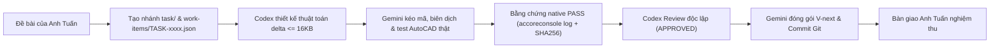

# HIỆP ƯỚC PHỐI HỢP VẬN HÀNH GIỮA GEMINI VÀ CODEX (TVXD-AI-PACT-20261123)
> **Dự án:** anhtuantvtkd-ui/TuanPa_AI  
> **Chủ sở hữu:** Anh Tuấn (anhtuantvtkd-ui)  
> **Cơ sở pháp lý & quy trình:** Kế thừa TVXD-WORKFLOW-20261103-SIMPLE & TUANPA-ENG-1  
> **Bên A:** Gemini (Antigravity) — Local Executor, Native AutoCAD Runner & Release Packager  
> **Bên B:** Codex (OpenAI Codex CLI, Model gpt-6-astra) — Lead Logic Designer & Independent Reviewer  

---

## 1. NGUYÊN TẮC CỐT LÕI
1. **Loại bỏ vai trò trung gian của Anh Tuấn:** Anh Tuấn chỉ giao đề bài và nghiệm thu sản phẩm cuối cùng. Mọi trao đổi kỹ thuật, phản biện thuật toán, chia sẻ diff giữa Gemini và Codex được thực hiện tự động và trực tiếp thông qua kết nối CLI cục bộ (`codex exec`) và cơ chế Git Watcher.
2. **Git Repo là Nguồn Sự Thật Duy Nhất (Single Source of Truth):**
   - Mọi mã nguồn, quy chuẩn, bài học kinh nghiệm và kết quả kiểm thử đều phải được commit và push lên Git.
   - Không có thỏa thuận miệng hay dữ liệu trôi nổi ngoài Git.
   - Phân biệt rõ: **Git Commit SHA** định danh trạng thái mã nguồn; **Mã băm SHA256** định danh tính toàn vẹn của artifact (DLL, ZIP, DWG).
3. **Quy tắc Single-Writer & Independent Review:**
   - Tại một thời điểm, mỗi file/scope chỉ có đúng một Writer duy nhất.
   - Mã nguồn do Executor (AI này) viết bắt buộc phải được Reviewer (AI kia) kiểm tra độc lập trên Git delta diff ($\le 16.000$ byte UTF-8) trước khi phát hành.
4. **Bảo tồn thành quả đã nghiệm thu:**
   - Mã nguồn đã PASS (TagSeq V15, T-TOADO V16) được chốt cứng bằng mã băm SHA256. Nghiêm cấm tự ý viết lại hoặc làm ảnh hưởng mã nguồn đã chạy ổn định.

---

## 2. PHÂN VAI TRÁCH NHIỆM

| Tiêu chí | Gemini (Antigravity) | Codex (OpenAI Codex CLI) |
| :--- | :--- | :--- |
| **Vai trò chính** | Local Executor, Native CAD Tester, Release Packager | Lead Logic Architect, Algorithm Designer, Independent Reviewer |
| **Môi trường** | Máy cục bộ (D:\TuanPa_AI), có quyền chạy PowerShell, accoreconsole, ilasm | Codex CLI (gpt-6-astra), phân tích logic thuật toán sâu, review bảo mật và rủi ro |
| **Nhiệm vụ cụ thể** | 1. Đọc và phân tích trực tiếp file DWG thật qua AutoCAD. 2. Build DLL, ILASM, biên dịch mã. 3. Chạy native test trên `accoreconsole` với bản vẽ thực tế. 4. Đóng gói bộ cài `OUTPUT/TVXD.BG` và cập nhật SHA256SUMS. 5. Đẩy commit lên Git Repo. | 1. Thiết kế giải thuật hình học, xử lý biên extents, DCS, UCS. 2. Soát lỗi delta diff của Gemini trước khi merge. 3. Độc lập phê duyệt (APPROVED / CHANGES_REQUESTED) trong `work-items/`. 4. Đúc kết bài học kỹ thuật vào kho tri thức. |

---

## 3. CHUỖI TRUY VẾT & NGHIỆM THU (AUDIT TRAIL)
Mọi tính năng mới hoặc bản sửa lỗi bắt buộc tuân theo chuỗi mắt xích khép kín:

---

## 4. CƠ CHẾ TÍCH LŨY TRI THỨC ("CÀNG LÀM CÀNG THÔNG MINH HƠN")
Để dự án ngày càng hoàn thiện và không bao giờ tái phát lỗi cũ:
1. **Chuỗi 5 bước đóng lỗi:**
   $$\text{Tái hiện lỗi} \longrightarrow \text{Bằng chứng nguyên nhân gốc} \longrightarrow \text{Sửa mã delta} \longrightarrow \text{Tạo Fixture hồi quy tự động} \longrightarrow \text{Đúc kết Lesson}$$
2. **Bộ Fixture Hồi Quy (Regression Test Suite):**
   - File `Danh so lien tiep.dwg` (32 block) được lưu thành test fixture chuẩn cho `TagSeq`.
   - File test tọa độ lớn (`BE2 DAN59` lệch 2.4 triệu đơn vị) được lưu thành test fixture chuẩn cho `T-TOADO`.
   - Khi phát triển tính năng mới, toàn bộ test suite này tự động chạy lại bằng `accoreconsole`. Nếu bất kỳ bài test cũ nào bị FAIL, hệ thống lập tức từ chối xuất bản.
3. **Kho tri thức sống (`DOCS/LEARNINGS.md`):**
   - Lưu trữ có cấu trúc: Tên triệu chứng, Nguyên nhân gốc, Commit xử lý, Quy tắc phòng tránh cho tương lai.

---

## 5. XÁC NHẬN ĐỒNG THUẬN
- **Đại diện Codex:** Đồng thuận bản hiệp ước làm chuẩn mực phối hợp (phiên `01a208a9-0fa1-7300-af62-94c9ab48376b`).
- **Đại diện Gemini:** Đồng thuận toàn diện, cam kết tuân thủ nghiêm ngặt và lưu vết trên Git Repo.
- **Ngày xác lập:** 23/11/2026.
