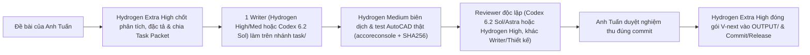

# HIỆP ƯỚC PHỐI HỢP VẬN HÀNH GIỮA GEMINI VÀ CODEX (TVXD-AI-PACT-20261123 — Rev.20261126)
> **Dự án:** anhtuantvtkd-ui/TuanPa_AI  
> **Chủ sở hữu:** Anh Tuấn (anhtuantvtkd-ui)  
> **Cơ sở pháp lý & quy trình:** Kế thừa TVXD-WORKFLOW-20261103-SIMPLE & TUANPA-ENG-1  
> **Tổng chỉ huy (Agent chính):** `Gemini 4 Hydrogen (Extra High)` — Chốt phân tích, đặc tả kỹ thuật, chia Task Packet & chỉ đóng gói khi đạt duyệt  
> **Đội nhân sự Gemini (Antigravity):** `Hydrogen High` / `Hydrogen Medium` / `Hydrogen Low` (+ `Gemini 3.8 Flash` dự phòng)  
> **Đội nhân sự Codex (OpenAI Codex):** `GPT-6.2 Sol/Astra`, `GPT-6.1 Sol/Terra`, `GPT-6 Astra/Sol/Luna`, `GPT-5.6 Sol/Terra/Luna` (kế thừa từ `gpt-6-astra`)  

---

## 1. NGUYÊN TẮC CỐT LÕI
1. **Loại bỏ vai trò trung gian của Anh Tuấn:** Anh Tuấn chỉ giao đề bài và nghiệm thu sản phẩm cuối cùng. Mọi trao đổi kỹ thuật, phản biện thuật toán, chia sẻ diff giữa Gemini và Codex được thực hiện chủ động thông qua `codex.exe exec` (do Tổng chỉ huy kích hoạt khi được phép ngoài sandbox) hoặc phiên Codex mở sẵn trên Git Repo (không có daemon Git Watcher chạy ngầm).
2. **Git Repo là Nguồn Sự Thật Duy Nhất (Single Source of Truth):**
   - Mọi mã nguồn, quy chuẩn, bài học kinh nghiệm và kết quả kiểm thử đều phải được commit và push lên Git.
   - Không có thỏa thuận miệng hay dữ liệu trôi nổi ngoài Git.
   - Phân biệt rõ: **Git Commit SHA** định danh trạng thái mã nguồn; **Mã băm SHA256** định danh tính toàn vẹn của artifact (DLL, ZIP, DWG).
3. **Quy tắc Single-Writer & Independent Review:**
   - Tại một thời điểm, mỗi file/scope chỉ có đúng một Writer duy nhất.
   - Mọi thay đổi mã nguồn/phát hành sản phẩm (C#, IL, LISP, bridge) bắt buộc phải được Reviewer độc lập (khác Writer và Thiết kế) kiểm tra trên delta diff ($\le 16.000$ byte UTF-8) trước khi Chủ sở hữu duyệt và đóng gói. Chỉ tác vụ cấp Nhẹ không chạm mã phát hành (tài liệu, checklist nội bộ, JSON hồ sơ) mới được dùng checklist tự kiểm + xác nhận của Chủ sở hữu theo `WORKFLOW.md`.
4. **Bảo tồn thành quả đã nghiệm thu:**
   - Mã nguồn đã PASS (TagSeq V15, T-TOADO V16) được chốt cứng bằng mã băm SHA256. Nghiêm cấm tự ý viết lại hoặc làm ảnh hưởng mã nguồn đã chạy ổn định.
5. **Kỷ luật khóa van Token (Bảo vệ Quota tối đa - Bất di bất dịch):**
   - Mọi gói giao việc và trao đổi mã nguồn chỉ truyền phần chênh lệch (`git diff`), giới hạn tối đa $\le 16.000$ byte UTF-8.
   - Nghiêm cấm việc AI tự tiện chạy lệnh quét đệ quy ổ đĩa (`Get-ChildItem -Recurse`, `rg --files`) đổ văn bản thô vào context làm bay token.
   - Lệnh gọi CLI cục bộ (`codex.exe exec ... -`) chỉ dùng để ping thông báo ngắn gọn ($\le 200$ từ / $\le 1\text{ KB}$) qua `stdin`, kèm commit SHA hoặc đường dẫn tệp diff/Task Packet ($\le 16\text{ KB}$) khi thiếu `git` trong PATH. AI nhận lệnh chỉ mở đúng tệp diff hoặc `git diff` của commit đó.

---

## 2. PHÂN VAI TRÁCH NHIỆM ĐA TẦNG MODEL (TỐI ƯU TOKEN)

### 2.1. Tổng chỉ huy (`Gemini 4 Hydrogen Extra High`)
- Giữ 4 quyền chốt: **Chốt phân tích**, **Chốt đặc tả kỹ thuật**, **Chia việc rõ ràng (Task Packet $\le 16\text{ KB}$)**, và **Chỉ đóng gói `OUTPUT/N. TVXD.BG VN` khi đã đạt duyệt**.
- Không tự làm việc lặp (đọc log dài, viết boilerplate, sửa hồ sơ/JSON) — giao xuống đội dưới.

### 2.2. Đội nhân sự Gemini & Codex (xem bảng đầy đủ tại `ROLES.md`)

| Tầng việc | Đội Gemini (`Antigravity`) | Đội Codex (`OpenAI Codex`) |
| :--- | :--- | :--- |
| **Kiến trúc & Review rủi ro cao** | `Hydrogen Extra High` (chốt spec) / `Hydrogen High` (gỡ ca IL, C#, CAD khó) | `GPT-6.2 Astra` (thiết kế giải thuật phức tạp, gỡ lỗi sâu, review rủi ro cao) |
| **Coder & Review thường (mặc định)** | `Hydrogen Medium` (LISP/C#/PS1, `build_v4.cmd`, `accoreconsole`) | `GPT-6.2 Sol` (mặc định lập trình, test & review thường khi bên khác viết) |
| **Kiểm tra trực quan UI/CAD** | `Hydrogen Medium` (chụp ảnh / xuất fixture) | `GPT-6.1 Terra` (kiểm tra trực quan CAD, Palette UI, WinForms layout) |
| **Tác vụ nhẹ & Dự phòng** | `Hydrogen Low` / `3.8 Flash` (`npm test`, `workflow:check`, SHA256, hồ sơ) | `GPT-6.1 Sol` / `6 Astra` (dự phòng); `GPT-6 Luna` / `5.6` (lọc log, JSON, checklist) |

> Chi tiết định tuyến theo 3 cấp độ việc (**Nhẹ / Vừa / Khó**), quy tắc Single-Writer / Independent Review (model thiết kế không tự review độc lập chính phần của mình), quy tắc fallback và lệnh `codex.exe exec` qua `stdin` lưu thống nhất tại `ROLES.md`.

---

## 3. CHUỖI TRUY VẾT & NGHIỆM THU (AUDIT TRAIL)
Mọi tính năng mới hoặc bản sửa lỗi bắt buộc tuân theo chuỗi mắt xích khép kín:

---

## 4. CƠ CHẾ TÍCH LŨY TRI THỨC ("CÀNG LÀM CÀNG THÔNG MINH HƠN")
Để dự án ngày càng hoàn thiện và không bao giờ tái phát lỗi cũ:
1. **Chuỗi 5 bước đóng lỗi:**
   $$\text{Tái hiện lỗi} \longrightarrow \text{Bằng chứng nguyên nhân gốc} \longrightarrow \text{Sửa mã delta} \longrightarrow \text{Tạo Fixture hồi quy tự động} \longrightarrow \text{Đúc kết Lesson}$$
2. **Bộ Fixture Hồi Quy (Regression Test Suite):**
   - File `Danh so lien tiep.dwg` (32 block) được lưu thành test fixture chuẩn cho `TagSeq`.
   - File test tọa độ lớn (`BE2 DAN59` lệch 2.4 triệu đơn vị) được lưu thành test fixture chuẩn cho `T-TOADO`.
   - Khi phát triển tính năng mới, toàn bộ test suite này tự động chạy lại bằng `accoreconsole`. Nếu bất kỳ bài test cũ nào bị FAIL, hệ thống lập tức từ chối xuất bản.
3. **Kho tri thức sống (`DOCS/LEARNINGS.md`):**
   - Lưu trữ có cấu trúc: Tên triệu chứng, Nguyên nhân gốc, Commit xử lý, Quy tắc phòng tránh cho tương lai.

---

## 5. XÁC NHẬN ĐỒNG THUẬN
- **Đại diện Codex (bản gốc 23/11/2026):** Đồng thuận làm chuẩn mực phối hợp (phiên `01a208a9-0fa1-7300-af62-94c9ab48376b`).
- **Đại diện Codex (`gpt-6.2-astra`, bản nâng cấp đa tầng Rev.20261126):** Đã phản biện qua `codex.exe exec` (`01a218d3`, `01a218d8`, `01a218d9`) và xác nhận **ĐẠT** sau khi hoàn thiện (phiên `01a218da-c478-7fd1-b7bc-52a510d9007e`, ngày 27/11/2026).
- **Đại diện Gemini (`Gemini 4 Hydrogen High`):** Đồng thuận toàn diện, cam kết điều phối đúng phân tầng model và lưu vết trên Git Repo.
- **Ngày cập nhật gần nhất:** 27/11/2026 (chờ Chủ sở hữu duyệt commit lên Git).
