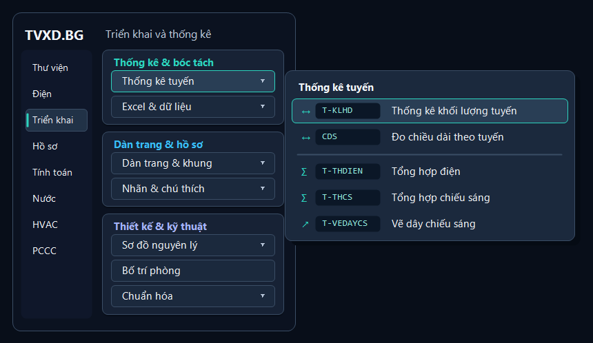

# TASK-0025 · Đề xuất thiết kế palette TVXD.BG

## 1. Kiến trúc hiện tại

| Nguồn | Quan sát | Hệ quả thiết kế |
|---|---|---|
| [CompactView06.cs](../../products/meps/src/Modules/CompactView06.cs#L24) | WinForms `UserControl` chứa thanh công cụ, tìm kiếm, bộ lọc thư viện và lưới block. Dùng kích thước logic nhân `Dpi`, `Fit()` xử lý cuộn dọc, `ArrangeActions()` chia chỗ cho các nút hành động. `FitActionFont()` và `ActionFits()` đo nhãn hành động theo chiều rộng ô. | Chỉ thay bố cục vùng công cụ. Giữ đường đi của tìm kiếm, bộ lọc, chọn/chèn block và callback CAD. |
| [CompactView06.cs:174](../../products/meps/src/Modules/CompactView06.cs#L174), [BuildLayoutMenu:833](../../products/meps/src/Modules/CompactView06.cs#L833) | `DarkMenuRenderer` và `DarkMenuColors` đã đổi màu chữ, trạng thái chọn, mũi tên, dấu kiểm và separator. Renderer áp dụng trên `groups` và submenu Điện. Menu Dàn trang được tạo riêng với `TextFont` và handler `LayoutClicked`. | Kế thừa các quy ước màu và trạng thái của renderer hiện có. Gắn renderer theo từng menu triển khai. |
| [meps_orig.il:48340](../../products/meps/tools/base/meps_orig.il#L48340), [FitVertical103:48431](../../products/meps/tools/base/meps_orig.il#L48431) | IL nối vùng công cụ với module `tools` của board và gọi lại `ArrangeActions()` khi đặt bounds. Constructor có các nhánh Excel, Input, SDNL, phòng, thống kê tuyến, danh mục bản vẽ và TAG. [ArrangeActions:62988](../../products/meps/tools/base/meps_orig.il#L62988) đặt bounds riêng cho từng nút. | Chênh lệch quan trọng giữa bản C# hiện có và bản IL. Dùng inventory IL để bảo toàn chức năng trước khi thay phần giao diện. Kích thước khoảng 75 px là hiện trạng mô tả trong spec, phụ thuộc chiều rộng dock và DPI. |
| [VerticalBoard103:718738](../../products/meps/tools/base/meps_orig.il#L718738), [constructor:720121](../../products/meps/tools/base/meps_orig.il#L720121), [OnLayout:721985](../../products/meps/tools/base/meps_orig.il#L721985) | Board sở hữu rail, vùng nội dung có cuộn, ánh xạ module/section và thông báo `SectionChanged`. Tám ID là `library`, `dien`, `tools`, `docs`, `calc`, `water`, `air`, `fire`. `OnLayout` tách `LayoutRail` và `LayoutBody`. IL đã có `Palette120` và `TintActions121`. | Board quản lý điều hướng, trạng thái chọn và màu nền chung. Vùng `tools` quản lý thứ tự nhóm, nút mở menu và trạng thái command. Kiểm tra đường gọi đổi màu cũ để tránh tô đè token mới khi đổi module. |

Chiều rộng nút và chiều rộng popup là hai bài toán riêng. Một hàng hai cột thu hẹp vùng chữ nút khi dock hẹp. Khi popup thiếu chỗ cho badge hoặc icon, renderer chỉ nhìn thấy hình chữ nhật đã được WinForms cấp. Cần sửa kích thước ưu tiên của item trước bước vẽ.

## 2. Gộp nút và giữ ánh xạ lệnh

Dùng ba card xếp dọc trong `tools`, bảy hàng điều hướng, mỗi hàng chiếm toàn chiều rộng. Hàng có nhiều mục mở dropdown qua cả mặt nút. Hàng có đúng một hành động như Bố trí phòng có thể gọi handler trực tiếp. Nút mở menu có chevron riêng và tên truy cập đầy đủ.

| Card | Nhãn mặt nút | Nội dung và cách chuyển |
|---|---|---|
| Thống kê & bóc tách | Thống kê tuyến ▾ | Dùng `RouteActions` và `RequestRouteStats` theo nhánh hiện hữu. Gợi ý separator giữa đo tuyến (`T-KLHD`, `CDS`), điện, chiếu sáng và các công cụ kiểm tra. Kiểm kê toàn bộ danh sách, gồm `STTPHA`, `T-THONGSO`, `T-KIEMTRA`, `T-THCS`, `T-THDIEN`, `T-VEDAYCS`, `T-VEDAYPL`, `T-DIMNET`. |
| Thống kê & bóc tách | Excel & dữ liệu ▾ | Đưa bảy mục từ `excelMenu` vào cùng nhóm, gồm `T-XLCONNECT051`, `T-XLMAP051`, `T-XLSIDE051`, `T-XLLENGTH051`, `T-XLREGION051`, `T-XLUNDO051`, `T-XLSTOP051`. Sau separator đặt Input với handler `floors054`. Dùng tên bao quát kết nối, thao tác và nhập dữ liệu. |
| Dàn trang & hồ sơ | Dàn trang & khung ▾ | Giữ `T-CK`, `T-STT`, `T-DTL`, `T-DTM`, `T-TKI` và trợ giúp. Nhóm hồ sơ tiếp theo chứa `MEPS_DANHMUC` và `MEPS_DANHMUC_CAPNHAT`. Thêm mục In PDF sau khi xác minh entry point và quyền chạy. |
| Dàn trang & hồ sơ | Nhãn & chú thích ▾ | Giữ mọi nhánh của `TagActions` và `TagSeqActions` qua handler hiện có. Đặt Ghi chú mặt bằng cùng nhóm sau khi đối chiếu handler và kiểm tra trạng thái bật/tắt. |
| Thiết kế & kỹ thuật | Sơ đồ nguyên lý ▾ | Giữ `SDNLLOAD`, `SDNLDRAW`, `SDNLUPDATESET`, `SDNLTEMPLATES`, `SDNLHELP` theo `sdnlMenu` và callback hiện hành. |
| Thiết kế & kỹ thuật | Bố trí phòng | Gọi lại handler của `room072` và `RequestRoom`. Dùng “Bố trí phòng & thiết bị” nếu inventory xác nhận phạm vi thiết bị. |
| Thiết kế & kỹ thuật | Chuẩn hóa ▾ | Phân nhóm Font, Dim và Text theo spec. Chủ sản phẩm xác nhận mã lệnh và menu gốc trước khi đưa vào danh sách phát hành. |

Nguồn ánh xạ gồm [constructor IL:50633](../../products/meps/tools/base/meps_orig.il#L50633), [RouteActions và TagActions:68463](../../products/meps/tools/base/meps_orig.il#L68463) và [các trường callback:43272](../../products/meps/tools/base/meps_orig.il#L43272). Rà thêm các hàng Đi dây/Flex, xuất hoặc hỗ trợ hồ sơ, và hành động Text `RequestTextWrite110` theo đúng module hiện hành trước khi bỏ bất kỳ control cũ nào. Mỗi mục cần ID ổn định, caption, badge CAD nếu có, callback sẵn có, điều kiện khả dụng và thứ tự. Badge dùng mã lệnh đã xác minh. Trợ giúp, Input và thao tác nội bộ có thể chỉ dùng icon và mô tả. Giữ nguyên ngữ nghĩa `Tag` của item cũ, nhất là bộ lọc nhóm.

## 3. Màu và kích thước

| Thành phần | Đề xuất |
|---|---|
| Palette / rail / card / popup | `#0B1220` / `#0F172A` / `#172235` / `#1B293D`. Viền `#3A4D65`. Tạo chiều sâu bằng phân lớp nền, viền 1 px và bóng nhẹ phía dưới card nếu host vẽ ổn định. |
| Chữ | Segoe UI 13–14 px logic, SemiBold cho tiêu đề, xuống dòng theo từ. Màu chính `#F1F5F9`, phụ `#B8C6D9`, disabled `#8796AB`. Badge dùng Consolas 12 px logic, nền `#0B1727`. |
| Accent | Teal `#2DD4BF` cho thống kê, cyan `#38BDF8` cho hồ sơ, indigo `#A5B4FC` cho kỹ thuật, amber `#FBBF24` cho cảnh báo. Gradient nhẹ Teal → Cyan dùng trên gạch nhấn mảnh của mục được chọn. |
| Trạng thái | Rail có nền chung, mục đang chọn có vạch accent, chữ sáng và nền nâng. Giữ thứ tự, ID, trạng thái khả dụng và phím điều hướng. Hover popup dùng `#293E55` kèm viền sáng. Focus bàn phím có viền rõ. Mục checked có dấu kiểm. Disabled dùng màu giảm sáng và giữ caption đọc được. |
| Bố trí hẹp | Tính theo `layoutHost.ClientSize` thực tế sau khi trừ padding và scrollbar. Bắt đầu với padding card 8 px, gap 6 px, hàng tối thiểu 36 px logic. Đo nhãn đủ theo phần còn lại sau icon/chevron, cho tăng chiều cao khi xuống dòng. Card cuộn dọc theo vùng nội dung của board. |

Mockup dùng dữ liệu minh họa và mô tả đề xuất. Rail, card và popup minh họa ba lớp giao diện. Badge minh họa mã lệnh lấy từ IL. Trạng thái hover có nền sáng hơn và vẫn giữ chữ tiếng Việt đủ dấu.

## 4. Renderer và layout dropdown WinForms

1. **Tách kích thước khỏi vẽ.** Tạo style riêng cho action menus từ `ToolStripProfessionalRenderer` và `ProfessionalColorTable`, gắn trên từng `ContextMenuStrip` và submenu có dùng cùng style. Dùng `ToolStripMenuItem` chuyên biệt có `GetPreferredSize` hoặc đặt `AutoSize=false` cùng kích thước tính trước cho toàn bộ action items. Giữ item/keyboard/accessibility WinForms. Tính theo DPI của owner/popup theo khả năng host. Nếu chỉ có DPI hệ thống thì kiểm chứng trên host thực tế và ghi giới hạn.
2. **Đo trước khi mở.** Khi `Opening`, dùng `TextRenderer.MeasureText` với font, DPI, vùng wrap và flags tương ứng với khi vẽ. Chừa padding hai bên, icon hoặc check 18 px, gap 8 px, cột badge bằng mã rộng nhất + padding, cột mô tả và vùng mũi tên submenu. Cộng viền và padding ngoài vào kích thước popup. Dòng một hàng tối thiểu 34 px logic. Với dòng quấn, lấy cao độ thực đo cộng padding trên/dưới. Chiều rộng dùng cùng phép tính cho mọi item trong một menu. Đo lại khi nội dung, font, DPI hoặc màn hình đổi. Nếu tự cấp cột icon/check, tắt các margin tương ứng của WinForms và tự vẽ trạng thái, tránh cấp chỗ hai lần.
3. **Giới hạn vào vùng làm việc của màn hình chứa điểm neo.** Chọn cạnh mở trước khi gọi `Show`, thử phải/trái hoặc dưới/trên tùy chỗ trống. Khi thiếu chiều rộng, co cột mô tả và wrap theo từ. Khi badge dài hoặc cửa sổ quá hẹp để giữ ba cột, đặt badge trên mô tả trong cùng item và đo lại chiều cao. Với menu cao, kiểm tra cuộn điều hướng chuẩn của WinForms trên host, đồng thời chia submenu theo nhóm nếu cần. Dùng working area của đúng màn hình, kể cả màn hình có tọa độ âm. Giữ popup độc lập với chiều rộng dock.
4. **Vẽ trong bounds đã cấp.** Dùng `OnRenderToolStripBackground` và `OnRenderToolStripBorder` cho nền, viền và góc 6–8 px logic. `RoundedEdges` riêng lẻ không tạo vùng cửa sổ bo góc. Ưu tiên viền nội tiếp trước, thử `Region` của popup sau nếu cần góc trong suốt thực, rồi kiểm tra lại hit-test và bóng trên AutoCAD. Dùng `OnRenderMenuItemBackground` cho hover/selected, `OnRenderSeparator` cho đường phân cách, `OnRenderArrow` cho submenu. Vẽ badge và mô tả trong các ô đã đo qua `OnRenderItemText` của loại item mới, tránh gọi vẽ chữ mặc định lần hai. Icon/check đi theo callback tương ứng hoặc cùng một phương thức vẽ có phần bounds đã cấp. Giải phóng bút, cọ, đường dẫn GDI và font thuộc quyền sở hữu của palette. High Contrast dùng renderer hệ thống với caption gồm cả mô tả và mã lệnh nếu có.
5. **Quản lý vòng đời và focus.** IL `get_Menus` chỉ trả ba menu thư viện [dòng 61846](../../products/meps/tools/base/meps_orig.il#L61846). Kiểm tra `AnyMenuOpen`, `CloseMenus` và call site trước khi quản lý chung menu công cụ, gồm Excel hiện tạo trong closure. Đóng popup khi đổi module, đổi bản vẽ hoặc đóng palette, trả focus đúng theo thao tác và hủy menu khi dispose. Esc chỉ thoát popup nếu chưa chọn. Click/Enter trên một mục gọi đúng một callback và duy trì cơ chế chuyển focus sang CAD của handler hiện hữu. Thử Tab, mũi tên, Enter, Esc và đọc caption bằng UI Automation.

## 5. Trình tự triển khai và nghiệm thu

1. Chốt ảnh mockup và danh mục hành động. Dùng checksum IL để xác định bản đọc. Chủ sản phẩm xác nhận bản DLL/source mục tiêu và mapping còn mở trước khi triển khai.
2. Dựng fixture WinForms tổng hợp với callback ghi nhận ID. Thay vùng `tools` bằng ba card, thêm builder/renderer cho popup, rồi tích hợp điều hướng rail. Kiểm tra callback đúng một lần và đối chiếu danh sách lệnh trước/sau. Thử menu ở rail dock trái/phải, floating, màn hình phụ và sát bốn mép.
3. Nghiệm thu trên AutoCAD/Windows đúng phiên bản với bản vẽ tổng hợp. Thử các bề rộng dock hỗ trợ gồm mức hẹp nhất, DPI 100/125/150/200%, chữ Việt có dấu, badge dài nhất và tên mô tả dài. Chụp ảnh popup dạng thường, hover, checked, disabled và submenu. Điều kiện đạt là mọi caption hiển thị đủ, dấu tiếng Việt nguyên vẹn, các vùng vẽ không chồng nhau, tất cả mục dùng được bằng bàn phím, và lệnh CAD giữ đúng prompt/hủy/undo theo chức năng.

## 6. Bàn giao

- Actor/model ghi nhận là Codex (GPT-6). `base_commit` của nhánh tài liệu từ `main` là `23bc0abda028d02ae2f77ff920ab707e188ba972`. Nguồn phân tích lấy từ workspace ở HEAD `e89e5b943a2a94593f95c93c208731b9ee33fd99` và đặc tả TASK-0025 do người dùng cung cấp tại workspace. IL khác giữa hai commit. Bản IL đã đọc được xác định bằng SHA-256 `0D026706EF42AC216B59E0BAC913B878973A2B87CF7E94AE066B666DA7D01BDD`. Các mốc dòng IL trong tài liệu trỏ theo bản đã đọc.
- Tệp mới gồm review này và PNG mockup trong cùng thư mục. Đã đọc đặc tả bằng `Get-Content -Encoding UTF8`, đối chiếu các vùng phương thức bằng `Select-String` và `ReadAllLines`, xác nhận checksum IL bằng `Get-FileHash -Algorithm SHA256`.
- Đã kiểm tra trực quan PNG 860 × 498. `npm.cmd ci --ignore-scripts` và `npm.cmd run type-check` thành công. `npm.cmd test` chạy đạt 19 bài kiểm thử rồi trả mã 1 ở bước kiểm tra hồ sơ. `npm.cmd run workflow:check` cũng trả mã 1 do các hồ sơ sẵn có TASK-0018, TASK-0019 và TASK-0020 thiếu SHA hoặc bằng chứng quy trình. Các lệnh npm chạy trên workspace đã phân tích.
- Mục còn mở gồm hồ sơ `work-items/TASK-0025.json`, mapping In PDF/Ghi chú mặt bằng/Chuẩn hóa và đối chiếu bản DLL triển khai. Nghiệm thu native ở trạng thái BLOCKED cho đến khi có bản triển khai và fixture AutoCAD. Bước tiếp theo là chốt danh mục lệnh và ảnh trước khi sửa nguồn.
