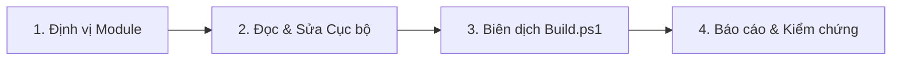

# QUY TẮC PHÁT TRIỂN TOOLS MEPS CHO AI (AI DEVELOPMENT RULES)

Tài liệu này giải quyết triệt để vấn đề: **"Tại sao AI nhiều lúc đi sai hướng, chệch hoàn toàn, nhưng có lúc lại rất nhanh?"**

---

## 1. NGUYÊN NHÂN GỐC RỄ KHIẾN AI ĐI SAI HƯỚNG TRONG DỰ ÁN NÀY

1. **Quá tải ngữ cảnh (Context Explosion)**: Trước đây 78 file `.cs` bị vứt chung vào một thư mục phẳng. Khi bạn yêu cầu "Sửa bảng khối lượng", AI phải quét qua hàng chục nghìn dòng code không liên quan (Ống gió mềm, Lưới đèn, Sơ đồ nguyên lý...), dẫn đến nhầm lẫn biến và sinh code lạc đề.
2. **Ẩn giấu cờ tính năng (Hidden Feature Flags)**: Hệ thống phụ thuộc vào 17 cờ biên dịch (`STANDARDS012`, `CABLES016`, `BDGKL034`...). Nếu AI không biết điều này, khi viết code mới sẽ xóa nhầm code trong `#if` hoặc sinh ra code thiếu định nghĩa.
3. **Đặc thù nghiệp vụ CAD không đồng nhất**:
   * Dùng màu RGB thay vì ACI Index (khiến in bản vẽ đơn sắc `monochrome.ctb` bị hỏng).
   * Không tôn trọng layer tiêu chuẩn (`E-BANG`, `TK-TUYEN-CS`).
   * Không kiểm tra UCS (User Coordinate System) khiến tọa độ 2D bị lệch trên không gian 3D.
4. **Không có quy trình Build & Kiểm chứng khép kín**: AI sửa xong nhưng không chạy lệnh `Build.ps1` để kiểm tra lỗi cú pháp, tự nhận là đã hoàn thành.

---

## 2. QUY TRÌNH PHÁT TRIỂN BẮT BUỘC CHO AI (STANDARD WORKFLOW)

Mỗi khi nhận nhiệm vụ từ kỹ sư, AI **bắt buộc** phải tuân theo 4 bước sau:



### Bước 1: Định vị chính xác Module
Chỉ can thiệp vào thư mục liên quan đến tính năng:
* Cần sửa bảng tính khối lượng, dim tuyến cáp 0.4kV? -> **`src/bdgkl/`**
* Cần sửa nét vẽ dây, kiểu đường cáp? -> **`src/wire/`**
* Cần sửa nhận diện ranh giới phòng, tính công suất W? -> **`src/room/`**
* Cần sửa bảng ký hiệu? -> **`src/legend/`**
* Cần sửa sơ đồ nguyên lý? -> **`resources/SDNL/`**
*(Tuyệt đối không đụng vào `src/core/` nếu không có yêu cầu thay đổi kiến trúc gốc).*

### Bước 2: Tuân thủ các nguyên tắc vàng của AutoCAD .NET
1. **Màu sắc**: Luôn ưu tiên dùng bảng màu ACI (AutoCAD Color Index 1–255, ví dụ ACI 2 = Vàng, ACI 7 = Trắng/Đen). Tránh dùng RGB thuần trừ khi xuất ảnh preview.
2. **Layer**: Luôn dùng đúng layer quy chuẩn (ví dụ bảng CAD vẽ trên `E-BANG`, tuyến cáp chiếu sáng vẽ trên `TK-TUYEN-CS`).
3. **Transaction an toàn**: Luôn đặt thao tác ghi dữ liệu CAD trong khối `using (Transaction tr = db.TransactionManager.StartTransaction())` và gọi `tr.Commit()`.
4. **Đơn vị & Tọa độ**: Tôn trọng biến hệ thống `INSUNITS` và tọa độ phẳng Z=0 cho các đối tượng 2D.

### Bước 3: Biên dịch kiểm chứng ngay lập tức
Trước khi trả lời người dùng, AI phải tự chạy:
```powershell
powershell -ExecutionPolicy Bypass -File "C:\Users\ADMIN\.gemini\antigravity\scratch\MEPS_ELECTRICAL\scripts\Build.ps1"
```
Nếu có lỗi (exit code != 0), AI phải tự sửa code cho đến khi biên dịch thành công.

---

## 3. MẪU PROMPT CHUẨN ĐỂ GIAO VIỆC CHO AI

Để AI làm việc với tốc độ nhanh nhất và **không bao giờ chệch hướng**, hãy dùng cấu trúc prompt sau:

> **[Phạm vi module]**: `src/bdgkl/`  
> **[Mục tiêu]**: Bổ sung thêm nhận diện kiểu dim cáp ngầm loại `4x240` vào bảng hạ thế 0.4kV.  
> **[Ràng buộc]**:  
> - Không sửa đổi các file ngoài `src/bdgkl/`.  
> - Bảng CAD xuất ra phải nằm trên layer `E-BANG`, màu chữ ACI 7.  
> - Chạy `scripts/Build.ps1` để xác nhận DLL build thành công trước khi trả lời.
